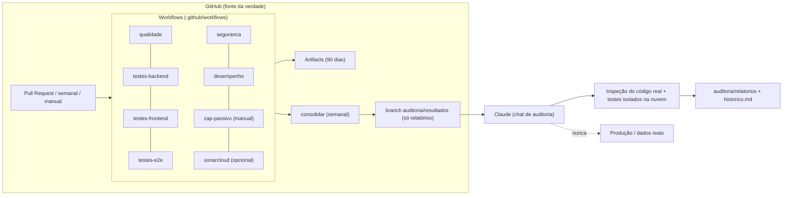

# Inventário e validação da Central de Auditoria (Etapa 10)

Data: 11/11/2026 · Base: commit `8112dd5` + branch `auditoria/central`

Legenda de **Resultado**: ✅ funcionou e foi testado aqui · 🟡 configurado, mas só poderá ser validado no GitHub ou depende de você · ⛔ não implantado.

**Regra:** uma ferramenta só conta como integrada quando foi executada com sucesso e produziu resultado.

## Ferramentas

| Ferramenta | Versão | Instalada | Configurada | Integrada (workflow) | Como o Claude aciona | Teste de funcionamento | Resultado |
|---|---|---|---|---|---|---|---|
| TypeScript (tsc) | 6.0.3 | já existia no projeto | sim | `qualidade.yml`, bloqueante | `npx tsc --noEmit` em `frontend/` | Rodou sem erros | ✅ |
| ESLint | 9.39.5 | sim (isolada em `auditoria/ferramentas/eslint`) | sim | `qualidade.yml` | `eslint -c auditoria/ferramentas/eslint/eslint.config.mjs frontend/src` | 166 arquivos: 6 erros, 22 avisos | ✅ |
| Ruff | 0.17.4 | sim (pip) | `auditoria/config/ruff.toml` | `qualidade.yml` | `ruff check backend --config auditoria/config/ruff.toml` | 70 ocorrências (554 sem filtro) | ✅ |
| Mypy | 2.4.1 | sim (pip) | `auditoria/config/mypy.ini` | `qualidade.yml` | `python -m mypy app --config-file ../auditoria/config/mypy.ini` | 143 erros de tipo em 43 arquivos | ✅ |
| SonarQube (SonarCloud) | — | não (serviço externo) | arquivo pronto, falta conta | `sonarcloud.yml` (pula sem token) | via relatório do serviço | Não executável sem conta | 🟡 depende de você |
| Pytest | 9.1.1 | já existia | `backend/pytest.ini` | `testes-backend.yml`, bloqueante | `pytest` em `backend/` | 604/604 | ✅ |
| HTTPX / TestClient | 0.27.0 | já existia (requirements) | `auditoria/testes_api/` | `testes-backend.yml` | `pytest auditoria/testes_api` | 9/9 + teste de mutação (detecta rota desprotegida) | ✅ |
| PostgreSQL de teste | 16.15 | sim (descartável) | porta 55432 aqui; serviço `postgres:16` no GitHub | todos os workflows que precisam | subir cluster temporário | Migrações aplicadas (50) | ✅ |
| Alembic | 1.13.1 | já existia | `backend/alembic.ini` | `testes-backend.yml` | `alembic upgrade head` | 50 migrações no banco de teste | ✅ |
| Vitest | 3.2.7 | sim (isolada) | `auditoria/ferramentas/frontend-testes` | `testes-frontend.yml` | `npx vitest run` | 11/11 | ✅ |
| Playwright | 1.65.0 | sim (isolada) | idem | `testes-e2e.yml` | `npx playwright test` | 4/4 com Chrome real, frontend+API isolados | ✅ |
| Testcontainers | — | não | — | — | — | Desnecessário: o `postgres:16` do GitHub já cumpre o papel | ⛔ dispensado, justificado |
| Semgrep | (instalado no GitHub) | só no GitHub | `p/python`, `p/typescript`, `p/owasp-top-ten` | `seguranca.yml` | ler relatório | Sem Docker/rede aqui | 🟡 1ª execução no GitHub |
| Gitleaks | (instalado no GitHub) | só no GitHub | `--redact` | `seguranca.yml` | ler relatório | Varredura própria por padrões feita aqui (menos completa) | 🟡 1ª execução no GitHub |
| Dependabot | — | serviço do GitHub | `.github/dependabot.yml` | automático | PRs semanais | Sintaxe validada | 🟡 vale após merge na branch principal |
| npm audit | 10.9.9 | já existia | — | `seguranca.yml` | `npm audit` em `frontend/` | 0 vulnerabilidades (produção) | ✅ |
| pip-audit | 2.10.1 | sim | — | `seguranca.yml` | `pip-audit -r backend/requirements.txt` | 40 vulnerabilidades (Pillow) | ✅ |
| OWASP ZAP | `zaproxy/zap-stable` | só no GitHub | passivo, manual, ambiente isolado | `zap-passivo.yml` | ler relatório | Docker indisponível aqui | 🟡 1ª execução no GitHub |
| Lighthouse | 13.6.0 | sim (isolada) | — | `desempenho.yml` | `npx lighthouse <url> ...` | Rodou com Chrome real | ✅ (resultado de desempenho inconclusivo: ver pendências) |
| Grafana k6 | 1.4.0 | sim (binário) | `auditoria/ferramentas/k6/linha_de_base.js` | `desempenho.yml` | `k6 run ...` | 1.240 req, p95 7,9 ms, 0 falhas | ✅ |
| Sentry | — | não | — | — | — | Exige conta e alteração do código | ⛔ aguardando sua decisão (ver `docs/AVALIACAO_SENTRY_E_MCP.md`) |
| GitHub Actions | — | serviço | 9 workflows + 1 ação reutilizável | — | `gh run`/aba Actions | `actionlint` sem erros; **nunca executado no GitHub ainda** | 🟡 |

## Ambiente

Node 22.23.4 · npm 10.9.9 · Python 3.11.18 (mesma do `backend/Dockerfile`) · Git 2.43.0 · PostgreSQL 16.15 · Docker CLI 29.9.3 (o serviço Docker **não** roda no ambiente de nuvem do Claude) · Chrome do sistema para Playwright/Lighthouse.

## Diagrama

## Pendências

1. **Executar os workflows no GitHub pela primeira vez** (abrir o Pull Request). Só então Gitleaks, Semgrep, ZAP e a ação reutilizável serão considerados validados.
2. **SonarCloud:** criar conta e o segredo `SONAR_TOKEN` (passo a passo no `README.md`).
3. **Sentry:** decisão sua (envolve conta externa e mudança no código).
4. **Lighthouse:** medir de novo no seu notebook e em um celular. O ambiente de nuvem não tem placa de vídeo, o que distorce a medição do globo 3D.
5. **Docker real do Radix** (Orthanc/OHIF em execução): auditar com o Docker Desktop ligado, pelo seu computador.
